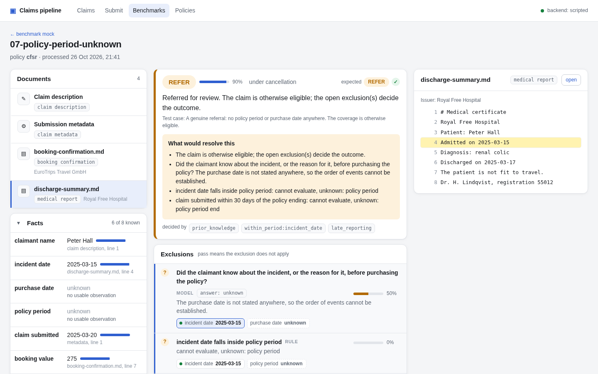
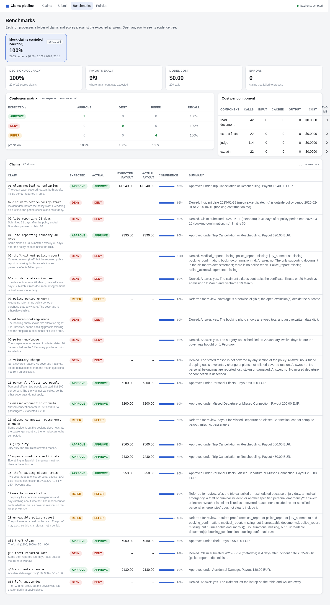

# Claims pipeline

An insurance claim processing pipeline where **the policy is code, the model reads, and code decides**.

A claim comes in as a description plus supporting documents (text, markdown, images in any language).
The pipeline reads every document, extracts the facts the policy cares about, runs the policy's checks,
and returns **APPROVE**, **DENY** or **UNCERTAIN** with a payout, a confidence, and an evidence tree that
links the decision to the exact document lines it rests on.

```
read documents  ->  extract facts  ->  assess trust  ->  run checks  ->  decide  ->  narrate
   (model)           (model)            (code)        (code + model)    (code)     (model)
```



## Why it looks like this

* **Policy as code.** A policy is one short Python file composed from about ten components:
  typed facts, proof rules, mechanical checks, one `judged` check for questions that need reading, a
  coverage, a payout formula. `claims_pipeline/policies/cfsr.py` reads line by line against
  `policy.md`; `gadget.py` is a second, deliberately different policy that shows a new policy is a new
  file of the same size and nothing else. See [docs/AUTHORING.md](docs/AUTHORING.md).
* **Code decides.** Every check answers *pass*, *fail* or *unknown*. Any failed exclusion denies. A
  matched coverage with its proofs present and every check passed approves. Anything still open is
  referred to a human with a list of what would resolve it. The model never chooses the outcome; it
  transcribes, extracts, answers narrow yes/no questions with a quote, and writes the explanation.
* **One data model.** The result tree (`claims_pipeline/domain/types.py`) is what the API returns,
  what the UI renders, what the benchmark scores and what the audit trail stores. Every fact carries
  its observations (document, line, quote, confidence); every check names the facts it consumed.
* **Swappable model components.** The four model-backed steps sit behind one interface
  (`claims_pipeline/llm/base.py`). Each has its own model and effort setting, every call is traced
  with tokens, cache hits, latency and cost, and a scripted backend replays recorded answers so the
  whole system runs offline and deterministically. That is also the seam for prompt tuning or
  fine-tuning a single component later.

## Two strategies, one comparison

The repository runs the same claims two ways and compares them:

| | **decomposed** (default) | **e2e** |
|---|---|---|
| what the model does | reads one document at a time, extracts facts with quotes, answers narrow yes/no questions | receives the policy, the task, the description and every document in one prompt and returns the decision |
| what code does | trust assessment, every mechanical check, the decision rule, the payout | nothing: the model's answer is the result |
| audit trail | decision → checks → facts → document lines | the model's written reasoning and the quotes it chose |
| model calls per claim | one per document, one extraction, one per judged question, one narration | one |
| when a policy changes | edit the policy file | edit the prompt's policy text |

```bash
poetry run python -m claims_pipeline.benchmark.run <claims> --backend openai --out results/decomposed
poetry run python -m claims_pipeline.benchmark.run <claims> --backend openai --strategy e2e --out results/e2e
poetry run python -m claims_pipeline.benchmark.compare results/decomposed results/e2e
```

(`--backend anthropic` for the Claude API; `CLAIMS_BACKEND` in `.env` sets the default.)

The comparison report puts accuracy, payout agreement, cost and latency side by side, counts the claims
each strategy got right that the other missed, and prints both summaries for every disagreement. Both
strategies fill the same result tree, so every e2e decision also opens in the UI and in the benchmark view.

## Setup

Requirements: Python 3.11+, [Poetry](https://python-poetry.org/) 2.x, Node 20+ (only to build the UI).

```bash
poetry install                                   # creates .venv in the project (see poetry.toml)
(cd ui && npm install && npm run build)          # optional: the web UI
poetry run pytest                                # 54 tests, all offline
```

Run the API (serves the UI at http://localhost:8000/ui/ and OpenAPI docs at /docs):

```bash
poetry run uvicorn claims_pipeline.api.app:app --reload
```

Configuration is by environment variable (or a `.env` file), prefix `CLAIMS_`:

| variable | default | meaning |
|---|---|---|
| `CLAIMS_BACKEND` | `scripted` | `scripted` (replay from oracle files, no model), `anthropic` (Claude API) or `openai` (any OpenAI-compatible server) |
| `CLAIMS_MODEL` | `claude-opus-5-5` | model for every component unless overridden (with `openai`: the server's model name) |
| `CLAIMS_OPENAI_BASE_URL` | – | the server's `/v1` base URL for `openai` |
| `CLAIMS_OPENAI_API_KEY` | – | Bearer token for `openai`, when the server wants one |
| `CLAIMS_OPENAI_TIMEOUT_S` | `600` | per-call timeout for `openai` |
| `CLAIMS_OPENAI_DISABLE_THINKING` | `true` | ask Qwen3-style templates to skip the think phase for JSON replies |
| `CLAIMS_MODEL_<COMPONENT>` | – | per-component override: `READ_DOCUMENT`, `EXTRACT_FACTS`, `JUDGE`, `EXPLAIN`, `E2E` |
| `CLAIMS_EFFORT_<COMPONENT>` | medium/high/high/low/high | reasoning effort per component |
| `CLAIMS_FALLBACKS` | `true` | server-side refusal fallback on the Claude API; set `false` behind a gateway |
| `CLAIMS_DATA_DIR` | `data` | SQLite database and uploaded files |
| `CLAIMS_DEFAULT_POLICY` | `cfsr` | policy used when a submission names none |
| `ANTHROPIC_API_KEY` | – | required for the `anthropic` backend |

### Running against a local model

Any OpenAI-compatible server works (llama.cpp `llama-server`, vLLM, LM Studio, a LiteLLM gateway).
Structured output is requested as a JSON schema (`response_format`), images go as data URLs, so the
model and server must handle vision for the photographed documents.

```bash
cp .env.example .env                              # edit the URL and model name
poetry run python -m claims_pipeline.benchmark.run mockclaims --backend openai --out results/mock-local
poetry run uvicorn claims_pipeline.api.app:app     # the API and UI, now calling the local model
```

The first command is the cheapest end-to-end smoke test: the 22 mock claims through the real model,
scored against their expected outcomes, with per-component tokens and latency in `results.md`.

## API

| method | path | purpose |
|---|---|---|
| `POST` | `/claims` | submit a claim (multipart: `description`, `policy`, `metadata` JSON, `submitted_at`, `strategy` = `decomposed` or `e2e`, `files[]`). Returns 202 and a `claim_id`; processing runs in the background. Add `wait=true` to process inline. |
| `GET` | `/claims` | summaries of every claim, newest first |
| `GET` | `/claims/{id}` | status plus the full result tree |
| `GET` | `/claims/{id}/documents/{doc_id}` | the uploaded file behind a document id |
| `GET` | `/policies`, `/policies/{name}` | a policy's composition as data, plus its wording |
| `GET` | `/benchmarks`, `/benchmarks/{run}` | benchmark runs found under `results/`, with per-claim results and documents |
| `GET` | `/health` | backend and per-component model configuration |

Example:

```bash
curl -s -X POST localhost:8000/claims \
  -F "description=I was admitted to hospital two days before departure and had to cancel." \
  -F policy=cfsr -F submitted_at=2025-03-25 \
  -F files=@hospital-certificate.md -F files=@booking-confirmation.png
# {"claim_id":"b5e9a2641c32","status":"processing", ...}
curl -s localhost:8000/claims/b5e9a2641c32 | jq .result.decision
```

The response's `result` holds `documents`, `facts`, `exclusions`, `coverages` and `decision`.
`decision.determining` lists the check ids that forced the outcome; each check lists `facts_used`
and `document_ids`; each fact lists `observations` with `document_id`, `line` and `quote`.

## Decision logic

For each policy, in this order:

1. **Exclusions.** Each is a check with PASS meaning "does not apply". Any FAIL denies.
2. **Coverages.** Each has a match question, a proof rule over document types, optional extra checks and
   a payout formula. A coverage is *eligible* (all pass, payout computable), *not applicable* (match
   answered no), *ineligible* (matched but a proof is missing or a check failed) or *unresolved*
   (something needed is unknown). An unknown match leaves the coverage unresolved: if we cannot say
   the reason is covered, we cannot call its proofs insufficient either.
3. **Outcome.** No coverage applicable: DENY (not a covered reason). An eligible coverage and no
   open exclusion: APPROVE, payouts of eligible coverages added. Only ineligible coverages and nothing
   open: DENY. Otherwise UNCERTAIN, with `unknowns` listing what a handler would need.
4. **Confidence** is computed, not asked for: the weakest link among the checks that decided, which in
   turn comes from fact confidences and the model's confidence on judged questions.
5. **Trust.** Documents the reader flags as altered become *questionable* or *untrusted* before any
   check runs; an untrusted document cannot serve as proof, and facts that disagree across documents
   mark both documents questionable. The CFSR policy also asks the model directly whether any document
   looks altered or inconsistent, as an exclusion.

## Benchmark

```bash
poetry run python -m claims_pipeline.benchmark.run mockclaims --out results/mock          # offline, scripted
poetry run python -m claims_pipeline.benchmark.run <claims folder> --policy cfsr --backend anthropic --out results/blind
```

(`poetry run claims-benchmark ...` is the same command as a console script.)

A claim folder holds `description.txt` and the documents; `expected.json` or `answer.json` gives the
expected outcome, optional `claim.json` gives the policy and submission date, and `oracle.json` holds
scripted model answers. The run writes one result JSON per claim plus `results.json` and `results.md`
with accuracy, a confusion matrix, per-outcome precision and recall, payout agreement, per-component
cost, and the evidence tree of every miss. Runs appear in the UI under *Benchmarks*.



`mockclaims/` is an adversarial set generated by `scripts/make_mockclaims.py`: one case per rule
(period boundaries, the 30-day reporting limit on both sides, missing proof, disagreeing dates, an
altered image, prior knowledge, a voluntary change, the connection formula with and without its inputs,
two coverages paying at once, a Spanish certificate, an unreadable attachment, an ambiguous weather
cancellation) plus four cases for the second policy. All 22 resolve as expected offline.

## Repository layout

```
claims_pipeline/
  domain/types.py       the result tree
  components/           facts, checks, coverage + proof rules, policy + decision rule, quantum, trust, explain, sources
  policies/             cfsr.py, gadget.py, texts/ (the policy wording)
  llm/                  backend interface, scripted backend, anthropic backend, per-component config, tracing
  pipeline.py           the five steps, same for every policy (decomposed strategy)
  e2e.py                the end-to-end strategy: one call, whole context
  api/                  FastAPI app + SQLite store
  benchmark/            loader, runner, report, compare
ui/                     React + Vite: claims, evidence view, submit, benchmarks, policies
mockclaims/             the adversarial offline set (generated)
docs/AUTHORING.md       how to compose a new policy
tests/                  components, decision rule, every mock claim end to end, API
```

## Assumptions and limits

* The benchmark's claims have no recorded submission date; the pipeline then relies on the
  description or documents for `claim_submitted`, and reports the 30-day check as unknown rather
  than guessing. The API uses the real submission time.
* Cancellation pays "up to the total bill": the formula pays the booking value when the proofs are in
  order, which is what a handler would do absent a stated lower amount.
* A new policy is a code change with review and deploy, not a runtime upload. That matches how
  insurers actually change policy terms, and keeps every rule reviewable in a diff.
* Image reading quality is the model's. Documents the reader cannot read are typed `unreadable` and
  turn missing proof into a referral instead of a denial.
